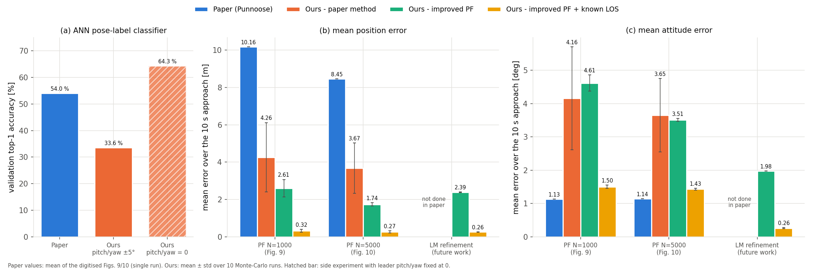

# Vision-Based Pose Estimation for Formation Flying (ANN + Particle Filter)

Re-implementation of *"Vision-Based Precision Pose Estimation For Autonomous Formation
Flying"* (R. Punnoose, Stanford) for the UE24CS352A Machine Learning mini-project.

A follower aircraft estimates the relative pose of a leader from 14 detected structural
features (simulated CNN detector output):

1. **ANN classifier** - 42 inputs -> 100 -> 100 (ReLU) -> 4800-way softmax, Adam. Predicts a
   discrete pose label (10x10x8x6 bins over x, y, z, roll - paper Table I). Pure NumPy.
2. **Particle filter** - 6-DoF state, nonlinear dynamics, synthetic-feature likelihood,
   `floor(aN)` particles resampled by weight, the rest drawn from *ANN label + error distribution*.
3. **Extensions** (beyond the paper): Gaussian likelihood option, Levenberg-Marquardt
   reprojection refinement (the paper's suggested future work), a known gimbal
   line-of-sight option (`--known-los`) that removes the bearing / attitude ambiguity,
   a softmax-mean ANN estimate, and a softmax PF proposal (`--proposal softmax`).

There is **no public dataset** for this paper: all data is generated synthetically (`data_gen.py`).

## Setup
```bash
pip install -r requirements.txt      # numpy, scipy, matplotlib (no PyTorch needed)
```

## Run (in order)
```bash
python data_gen.py --n-train 600000 --n-val 40000   # 1. synthetic dataset -> data/*.npz (~1 min)
python train_ann.py --epochs 20                      # 2. train ANN, Figs 4 & 5 -> models/, results/
python simulate.py                                   # 3. 10 s approach, Figs 6, 9, 10 (10 Monte-Carlo runs)
python simulate.py --likelihood gauss --refine       # 4. extensions
python simulate.py --likelihood gauss --refine --known-los
python simulate.py --likelihood gauss --proposal softmax                        # 5. improved PF
python simulate.py --likelihood gauss --proposal softmax --sigma-px 1 --known-los
python summarize.py                                  # 6. all runs -> results/summary_table.md
python compare_paper.py                              # 7. paper vs ours -> results/paper_vs_ours_*.png
python visualize.py                                  # 8. example detected / occluded features
```
The paper's curves used by step 7 are already in `paper_data/`; they were digitised from the
paper's Figs. 9/10 with `python digitize_paper.py ../Punnoose.pdf` (needs `pip install pypdf pillow`).
Training takes 15-70 min on a CPU with these settings (40 s - 3.5 min/epoch depending on the
machine); the best-validation weights are checkpointed every epoch. For a quick run use
`--n-train 100000 --epochs 10`. `python train_ann.py --eval-only` re-evaluates the saved model
without training.

The trained model (`models/ann.npz`, `models/error_pool.npy`) is committed, so the **live demo
only needs step 3**; use `python simulate.py --seeds 1` for a fast (~10 s) single run.
`simulate.py` reports mean +- std over `--seeds` runs (fresh detector noise and PF randomness
each run) in `results/summary_*.json`; plots show the first run.

## Files
| File | Purpose |
|---|---|
| `config.py` | camera, Table I bins, dynamics constants |
| `aircraft.py` | 14-feature aircraft model, gimballed pinhole camera, ray-based occlusion |
| `discretize.py` | pose <-> 4800 labels |
| `data_gen.py` | synthetic dataset generator |
| `ann.py`, `train_ann.py` | NumPy MLP + Adam, training and validation figures |
| `dynamics.py` | simplified relative-motion model |
| `particle_filter.py` | ANN-informed particle filter |
| `refine.py` | LM reprojection-error refinement (extension) |
| `simulate.py` | scenario, metrics, plots |
| `summarize.py` | collects all `summary_*.json` into one Markdown table |
| `digitize_paper.py`, `paper_data/` | paper Figs. 9/10 traced from the PDF into CSV |
| `compare_paper.py` | paper vs ours figures (time series + summary bars) |
| `visualize.py` | feature visualisation |

## Results (10 Monte-Carlo runs, mean ± std)


Paper (digitised Figs. 9/10, one run): mean position error 10.2 m (N=1000) / 8.5 m (N=5000),
mean attitude error 1.1°. Our attitude error is the full 3-D rotation angle, which includes the
unlabelled leader pitch/yaw; the paper does not define its attitude metric.

ANN on the validation set: top-1 33.6 %, top-5 81.1 %, 83 % of misclassifications land in an
adjacent bin. 3-D position RMS: 8.25 m (arg-max bin centre) -> 6.10 m (softmax mean).

| Method (10 s approach scenario) | No LOS: position / attitude | Known LOS: position / attitude |
|---|---|---|
| ANN only, arg-max bin (paper) | 6.02 m / 5.04° | 4.12 m / 5.04° |
| ANN only, softmax mean | 3.09 m / 2.85° | 1.62 m / 2.85° |
| PF N=5000, inverse-MSE likelihood (paper) | 3.87 ± 1.42 m / 3.65° | - |
| PF N=5000, Gaussian likelihood | 2.05 ± 0.54 m / 3.67° | 1.50 ± 0.18 m / 3.21° |
| PF N=5000, Gaussian + softmax proposal | 2.07 ± 0.08 m / 3.51° | **0.32 ± 0.07 m / 1.43°** (σ = 1 px) |
| LM reprojection refinement | 2.54 m / **1.98°** | **0.31 m / 0.26°** |

* **Why top-1 is 33.6 % vs 54 % in the paper:** our leader pitch/yaw vary by ±5° and are not in
  the label. With pitch/yaw fixed at 0 (`ATT_LIMIT_DEG = 0` when generating data) the same
  100-100 network reaches 64 % top-1. A 512-512 network on 2M samples reaches 38 % top-1 but
  gives no end-to-end gain (both were side experiments trained with PyTorch on a GPU).
* **Softmax proposal** mainly makes the PF stable: run-to-run std drops from 0.54 m to 0.08 m.
* **LM refinement** converges to the same answer from every starting point (ANN or PF), so
  "PF + LM" rows equal "ANN + LM".
* The inverse-MSE PF is very sensitive: a ~1e-7 rad change in injected particles moves its
  10-run mean by ~0.3 m.

## Conventions and simplifications (document these in the write-up)
* Pose = `[x, y, z, phi, theta, psi]`; `(x,y,z) = r_F/L` (follower relative to leader, x=-90 means 90 m behind).
* Camera gimballed at the leader, image "down" aligned with world down. Pinhole f=1000 px, 1280x960, 0.5 px detector noise.
* Features undetected if occluded (fuselage ellipsoid + wing slab ray test) or outside the image.
* Leader pitch/yaw are sampled in +-5 deg and are *not* part of the label (as in the paper).
* Pitch -> vertical velocity and roll -> lateral velocity via `V_NOM*sin(angle)` (our interpretation of the paper's brief dynamics description).
* PF initial/injected particles use the empirical (true pose - classified pose) error pool from the validation set
  (the paper's text cites Fig. 5 but describes this true-vs-classified error, i.e. Fig. 4).
* **Bearing ambiguity.** Because the camera always points at the leader and (as in the paper) the
  gimbal angles are not an input, a change of bearing looks almost like a change of leader
  pitch/yaw. Pose-only refinement therefore plateaus at ~2 m / ~2 deg. With `--known-los`, the
  follower uses its own gimbal pointing (0.1 deg noise): PF particles are moved onto the
  measured bearing and LM gets a bearing residual, which brings refinement down to ~0.3 m.
